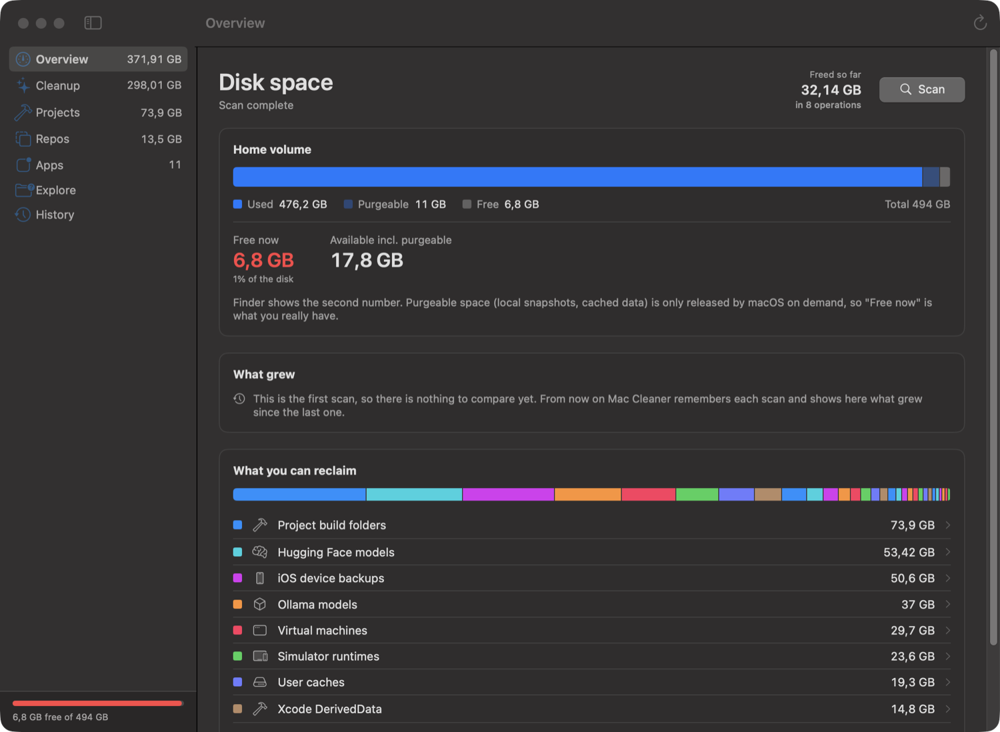
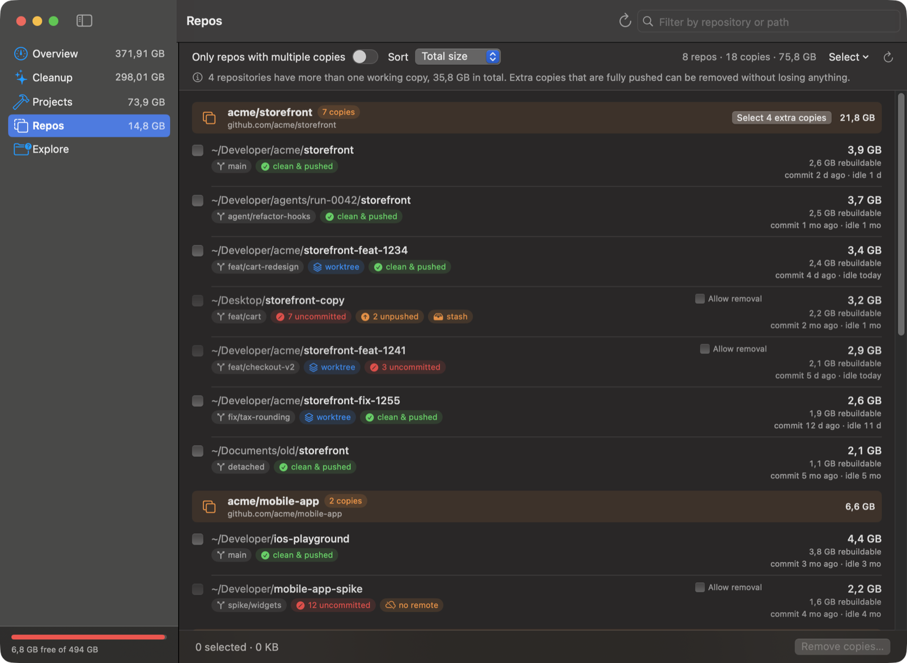
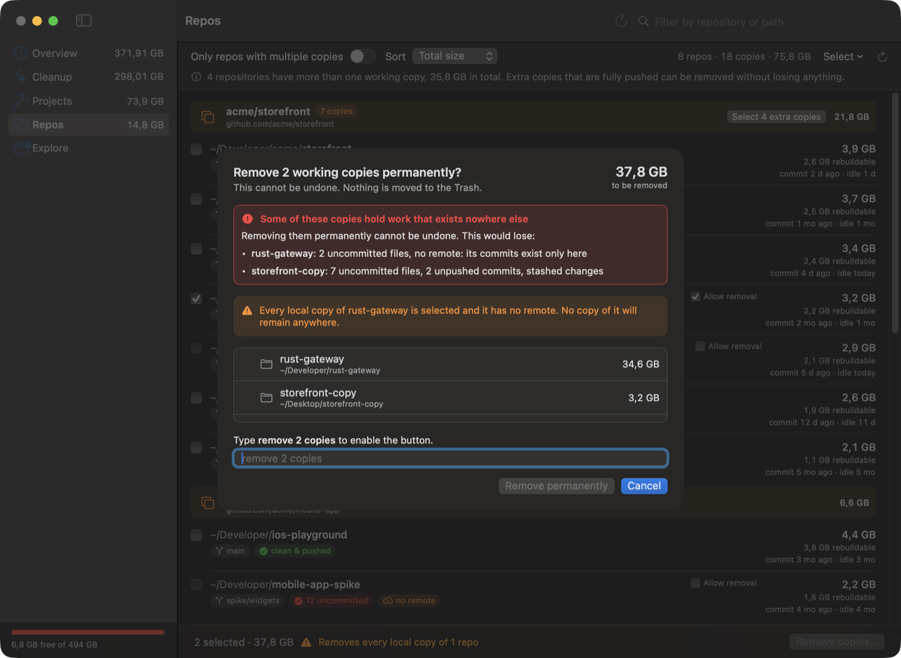
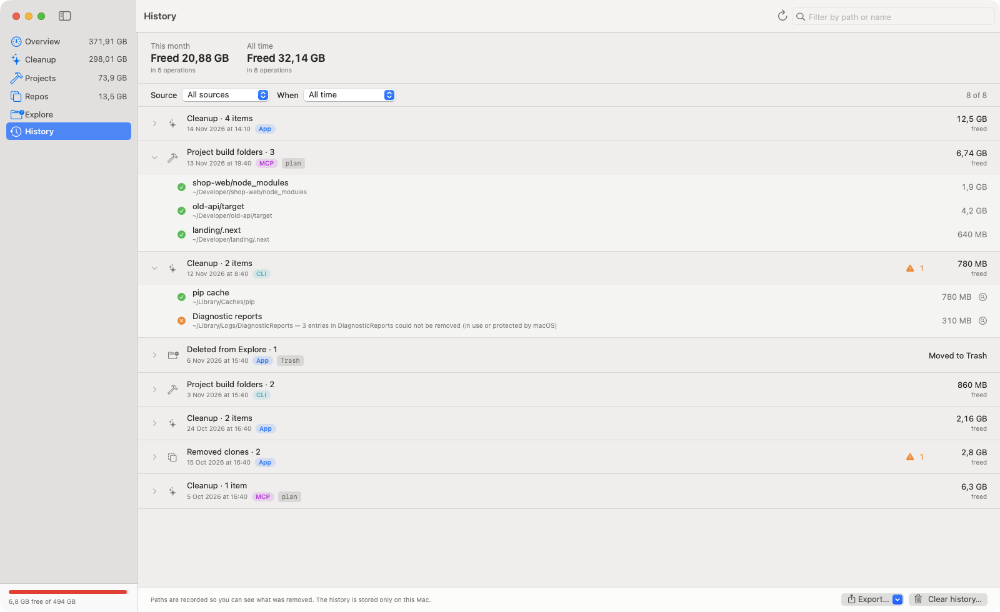

<p align="center">
  
</p>

<h1 align="center">Mac Cleaner</h1>

<p align="center"><strong>Disk cleaner for developers who ship with AI agents.</strong></p>

<p align="center">
  <a href="https://github.com/baturox/mac-cleaner/actions/workflows/ci.yml"></a>
  <a href="https://github.com/baturox/mac-cleaner/releases"></a>
  <a href="LICENSE"></a>
  
</p>

<p align="center">
  
</p>

<table>
  <tr>
    <td></td>
    <td></td>
  </tr>
  <tr>
    <td></td>
    <td></td>
  </tr>
  <tr>
    <td colspan="2"></td>
  </tr>
</table>

Mac Cleaner is a free, open-source macOS app (with a command-line tool) that frees up the disk space developers actually lose: `node_modules` and Rust `target` folders in dozens of projects, duplicate git clones and worktrees left behind by coding agents, Claude Code / Cursor / Codex session data, Hugging Face and Ollama model downloads, npm / pnpm / uv / Homebrew caches, Xcode DerivedData and simulators, Docker images.

If your Mac says the disk is full and "System Data" is enormous, this is the tool that tells you which folders it really is, and which of them are safe to delete.

## Why another cleaner?

If you build many projects with AI coding agents (Claude Code, Cursor, Codex, ...), the disk fills up in ways a generic cleaner does not understand:

- the 34 GB that is "System Data" is one Rust `target` folder,
- 13 agent-made clones of the same repository, each with its own `node_modules`,
- months of agent transcripts and session data,
- three different model caches (Hugging Face, Ollama, LM Studio) holding models you tried once.

Mac Cleaner knows these places. It shows what each one is, how big it is, whether deleting it is safe, and when you last touched it. Then you choose.

## Features

- **Real disk numbers.** Free space right now, next to the "available" number Finder shows (free plus purgeable), with an explanation of the difference.
- **Grouped cleanup**, each item marked *safe* or *caution*:
  - System & apps
  - Package managers
  - Xcode & mobile
  - AI coding tools: Claude Code, Cursor, Windsurf, VS Code, Codex and Gemini CLI session data, orphaned workspace storage, old extension versions, Playwright browsers
  - AI models: Hugging Face, Ollama, LM Studio and others, picked one model at a time with last-used dates
  - Language toolchains: old Node, Rust and Python versions, Android SDK pieces
  - Containers & VMs: a Docker breakdown
  - Personal data
- **Projects.** Stale build folders (`node_modules`, `target`, `.next`, `Pods`, `.venv`, ...) across all your projects, with how long each project has been idle.
- **Repos.** Every clone and worktree, grouped by repository, with a "clean & pushed" status, so leftover agent worktrees can be removed without losing work.
- **Explore.** Drill down by size, like a disk-usage tree.
- **What grew.** What got bigger since the last scan: the answer to "what filled my disk?".
- **History.** A local audit log of every deletion, unless you turn it off (what, how big, by the app, the CLI or an AI agent, and whether it worked), searchable and exportable.
- **MCP server for AI agents.** `mac-cleaner mcp` lets Claude Code, Cursor, Codex and others inspect disk usage and, only if you opt in, run a tightly limited two-step cleanup.
- **Menu bar item** with a low-space warning.
- **Delete permanently or move to the Trash**, and **protected folders** that are never touched.
- **A CLI** with `--json` output on every read command.

## Install

### Download (recommended)

1. Download `MacCleaner-<version>.dmg` from the [latest release](https://github.com/baturox/mac-cleaner/releases/latest).
2. Open it and drag **Mac Cleaner** to **Applications**.
3. Read the next section before the first launch.

Each release also contains a `.zip` of the app, a CLI-only `.tar.gz`, and `SHA256SUMS` to verify the downloads.

### Signed and notarized

Release builds from 0.1.2 on are **signed with a Developer ID and notarized by Apple**, so macOS opens the app and the `mac-cleaner` command without a Gatekeeper warning. Each release's notes say how that build was signed. (0.1.0 was ad-hoc signed and not notarized; use a newer release.)

You are free to read the source and [build it yourself](#build-from-source) instead.

### Homebrew

```sh
brew install --cask baturox/tap/mac-cleaner
```

This installs the app into `/Applications` and links the `mac-cleaner` command, from the tap [`baturox/homebrew-tap`](https://github.com/baturox/homebrew-tap). The cask pins the SHA-256 of the release DMG. The cask's source template is in [`packaging/homebrew/`](packaging/homebrew/mac-cleaner.rb).

### Build from source

Requires macOS 14+ and Xcode (or the Swift toolchain). No third-party dependencies.

```sh
git clone https://github.com/baturox/mac-cleaner.git
cd mac-cleaner
scripts/build-app.sh --open      # builds dist/Mac Cleaner.app (universal) and opens it
```

### Install the command-line tool

The app contains the CLI at `Mac Cleaner.app/Contents/Resources/bin/mac-cleaner`. To put it on your `PATH`:

```sh
scripts/install-cli.sh           # symlinks into /usr/local/bin or ~/.local/bin
```

Or build only the CLI with `swift build -c release --product mac-cleaner` and run `.build/release/mac-cleaner`.

## Full Disk Access

macOS hides parts of your home folder (Mail, Messages, Safari data, some app containers) from programs that have not been granted **Full Disk Access**. Without it, some sizes come out too small and some deletions fail with "operation not permitted". Mac Cleaner works without it, and the Overview tells you when it is missing.

To grant it: **System Settings > Privacy & Security > Full Disk Access**, add *Mac Cleaner*. For the CLI, grant it to your terminal app. `mac-cleaner doctor` reports the current status. Mac Cleaner never asks for more than that.

## Using the app

1. **Overview** shows free space now versus "available", the biggest things you can reclaim, and what grew since the last scan.
2. **Cleanup** lists categories by group. Tick what you want, review the list, confirm. Models, toolchain versions and simulator runtimes can be picked one by one.
3. **Projects** lists rebuildable build folders with project idle time. Old, idle, big ones first.
4. **Repos** lists every clone and worktree by repository, with its status. Remove the ones that are fully backed up: committed, pushed to a network remote, and with no ignored files (such as `.env`) that exist only there. A copy that is not backed up can only be selected after you turn on *Allow removal* for that one copy and type a confirmation phrase.
5. **Explore** drills into any folder by size.
6. **History** lists every deletion newest first (when, by which client, what, how much, how many failed), with a search over paths and names, filters by client and date, the items of each operation with *Reveal in Finder* for those that still exist, *Export…* (JSON or CSV) and *Clear history…*. Overview shows *Freed so far* from the same log. See [History and privacy](#history-and-privacy).

Settings hold the protected folders and how old AI session data must be before it is offered (default 30 days). Both are stored in `~/Library/Application Support/MacCleaner/settings.json`, which the command-line tool reads too, so a folder you protect in the app is protected in the CLI. Deleting can be permanent or move items to the Trash.

## Using the CLI

```
mac-cleaner [command] [options]

  scan       Disk numbers and everything that can be reclaimed (default)
  clean      Delete selected categories (asks first)
  projects   Rebuildable build folders in idle projects
  repos      Every git clone and worktree, grouped, with backup status
  explore    The biggest children of a folder
  growth     Save a snapshot and show what grew since the previous one
  history    What Mac Cleaner deleted (the local audit log); `history clear` erases it
  mcp        MCP server on stdio for AI coding agents
  doctor     Explain the disk numbers and report the environment
```

Global options: `--json`, `--no-color`, `--protect <path>`, `--version`, `-h/--help` (also `mac-cleaner help <command>`). Colors appear only on a terminal.

**Protected folders and retention.** The CLI obeys the protected folders and the session retention period you set in the app (it reads the same `settings.json`). `--protect <path>` adds a folder for one run and can be repeated. `mac-cleaner doctor` prints the list in force. If the settings file exists but cannot be read, scanning continues with defaults and a warning, and every command that would delete **refuses to run** until the file is fixed (open the app once, or remove the file).

File names, branch names and labels are data: when they are printed for you, control characters and escape sequences in them are replaced by `�`. `--json` output is not rewritten (JSON escaping already neutralizes them). Exit codes: `0` success, `1` runtime failure (or some items could not be removed), `2` usage error, `130` cancelled with Ctrl-C.

Sizes use decimal units, like Finder (1 GB = 1,000,000,000 bytes). A "≤" in front of a size means an upper bound: only part of it is actually freed (the pnpm store, Docker's disk image).

### Scan

```
$ mac-cleaner scan
Disk  ███████████░░░░░░░░░░░░░  47% used
  Free now     263 GB   really free on the volume
  Available    281 GB   what Finder shows (includes 18.0 GB purgeable)
  Total        494 GB

Package managers  7.9 GB
  #  ID    Name                  Level      Size  What it is
  1  npm   npm / npx cache       safe     6.2 GB  Re-downloaded on demand
  2  bun   Bun install cache     safe     1.7 GB  Re-downloaded on demand

AI models  9.4 GB
  #  ID         Name                            Level      Size  What it is
  3  hf-models  Hugging Face downloaded models  caution  9.4 GB  Large model files, re-downloadable
  ...

Total reclaimable  42.7 GB  (31.5 GB safe, 11.2 GB caution)
```

(The categories above are illustrative; your machine will show its own.)

### Clean

```sh
mac-cleaner clean                          # interactive picker: 1,3-5, s = all safe, a = all
mac-cleaner clean --safe -n                # preview every safe category, delete nothing
mac-cleaner clean --safe --group packageManagers -y
mac-cleaner clean npm hf-models --trash    # specific ids, moved to the Trash
```

`--safe` selects "safe" categories, `--all` everything, `--group <name>` narrows either to one group (`system`, `packageManagers`, `xcode`, `aiTools`, `models`, `toolchains`, `containers`, `personal`). `--group` on its own means the **safe** categories of that group: "caution" categories are only ever selected by `--all` or by naming their ids. Explicit ids are added on top. Mac Cleaner prints the plan, including the items behind every category (the first 8 of each, then "… and N more" with their size), and asks for confirmation unless you pass `-y`. It **refuses to delete when it is not on a terminal and `-y` is missing**.

### Projects

```
$ mac-cleaner projects ~/Developer --days 60 -n
  #     Size  Idle  Folder        Project
  1  2.1 GB   4 mo  target        ~/Developer/acme/ledger
  2  812 MB   3 mo  node_modules  ~/Developer/acme/storefront
  3  406 MB   2 mo  .next         ~/Developer/acme/storefront

Total 3.3 GB  in 3 folders - all rebuildable (npm install, cargo build, …)
```

Options: `--days N` (default 30), `--min-mb N` (default 50), `--kind node_modules,target`, `--trash`, `-n`, `-y`. A folder inside a git repository is listed only when git reports no tracked file in it; that also holds when you scan a sub-folder of a repository (`projects app/ios`), because the repository above the folder you named is looked up first. The build folders of a repository whose git configuration is not trusted (see *Repos*), or in which git fails, are not listed, because checking them would mean running git there. *Idle* is the newest change anywhere in the project outside its build folders and `.git/objects`; a project too big to check completely (more than 100,000 entries) counts as touched today.

### Repos

```
$ mac-cleaner repos ~/Developer --multiple-only
acme/storefront  4 copies, 3.4 GB
     Size   Idle  Branch    Kind      Status                    Path
  1.9 GB    2 d   main      clone     3 uncommitted             ~/Developer/acme/storefront
  820 MB   40 d   agent-1   worktree  clean & pushed            ~/Developer/acme/storefront-wt-1
  410 MB   41 d   fix-cart  clone     clean & pushed            ~/Developer/old/storefront
  300 MB   90 d   main      clone     2 unpushed                ~/Desktop/storefront copy
```

Statuses: `clean & pushed`, `N uncommitted`, `N file(s) hidden from git status`, `N unpushed`, `no remote`, `N ignored-only`, `stash`, and `untrusted git config - not inspected`; worktrees are labeled in the *Kind* column.

- **Unpushed** counts commits reachable from `HEAD`, any local branch or any tag that no remote-tracking ref of a *network* remote contains. A detached `HEAD` with local commits counts. A remote that is a folder on this disk (a path or a `file://` URL) is not a backup: such a clone shows `no remote`.
- **Ignored-only** counts files and folders that git ignores and that are not build output: `.env`, local databases, editor settings. They exist only in that copy. Build folders (`node_modules`, `dist`, `target`, …) and droppings (`.DS_Store`, `*.pyc`, `*.log`) are not counted.
- **Hidden from git status** counts tracked files that are on disk and flagged `skip-worktree` or `assume-unchanged` in git's index. git does not report edits in such files, so Mac Cleaner cannot verify them and treats the copy as not backed up. (Files of a sparse checkout that are not on disk do not count.)
- **Stash** also shows when git could not say whether there is a stash: what cannot be checked counts against the copy.
- A **linked worktree** on a branch keeps its commits in the main clone, so only its files matter. A *detached* worktree is backed up only if a network remote has its `HEAD`. A worktree is removed like any other folder; afterwards `git worktree prune` is run in the main clone, unless that clone is protected or untrusted (then you are told to run it).
- **Untrusted git config.** A repository's own `.git/config` can name programs that git runs during ordinary commands (`core.fsmonitor`, content filters such as `filter.lfs.*`, `core.hooksPath`, aliases, includes…). Mac Cleaner reads the configuration first and, unless every setting is on a list of harmless ones, does **not run git in that repository at all**. The same happens when the files that say where the repository lives (`.git` as a file, `commondir`) contain anything Mac Cleaner and git might read differently, such as a trailing space. It is listed with its size and the names of the offending settings, and it is never removed from here. Git LFS repositories fall under this (the LFS filter is a program); that is deliberate.

`repos --remove-clean` removes only working copies that are fully backed up (inspected, nothing uncommitted, nothing hidden from git status, nothing unpushed, no stash, no ignored-only files, no nested repository or linked worktree with work of its own), **never forces**, and **always keeps at least one working copy of each repository**. Preview it with `-n`.

### Explore, growth, doctor

```sh
mac-cleaner explore ~/Library --top 8   # biggest children of a folder
mac-cleaner growth                      # snapshot + what grew since the previous one
mac-cleaner doctor                      # disk numbers, Full Disk Access, protected folders, tools found, APFS volumes, snapshots, swap
```

`doctor --json` is what we ask for in bug reports. It contains numbers, tool locations and your protected-folder list (remove that from the paste if the paths are private), but no other file names. The tool locations are the ones Mac Cleaner itself would run (see *Safety model*), which can differ from your shell's `PATH`.

### History

```sh
mac-cleaner history                                  # the newest 20 operations
mac-cleaner history --since 7d --client mcp --items  # what AI agents removed this week, item by item
mac-cleaner history --json                           # full records (paths included)
mac-cleaner history clear                            # erase the history (asks first; -y to skip)
```

`--since` takes a date (`2025-01-31`) or an age (`24h`, `7d`, `2w`); `--client` is `app`, `cli` or `mcp`; `--limit N` caps the rows. An operation marked `(interrupted)` has no result on record: its process ended before it finished, or it is still running. `--items` then lists what it was *about to* remove; some, all or none of it may be gone. Terminal output has control characters in names replaced, like every other command.

### JSON output

Every read command takes `--json` and prints **only** JSON on stdout (progress and messages go to stderr). `--json` never deletes: with `clean`, `projects` and `repos` it implies `--dry-run`.

```sh
mac-cleaner scan --json | jq '.categories[] | {id, group, sizeBytes}'
mac-cleaner projects ~/Developer --json | jq '.totalBytes'
```

All documents carry `"schemaVersion": 1`; fields are only ever added within a schema version. Dates are ISO 8601 (UTC), sizes are bytes, and paths inside engine types are `file://` URLs.

| Command | Top-level fields |
| --- | --- |
| `scan` | `disk`, `categories[]` (id, name, detail, level, group, items[], commands, sizeBytes, sizeIsUpperBound, itemsSelectable), `exactBytes`, `upperBoundBytes`, `safeBytes`, `cautionBytes` |
| `clean -n` | `dryRun`, `mode`, `selected[]` (same as categories), `exactBytes`, `upperBoundBytes` |
| `projects` | `root`, `minDaysIdle`, `minBytes`, `kinds`, `artifacts[]` (url, kind, projectURL, sizeBytes, idleDays), `totalBytes` |
| `repos` | `root`, `groups[]` (id, name, remote, totalBytes, `clones[]` with `clone` (includes `ignoredFileCount`, `hiddenFromStatusCount` and, for a copy that was not inspected, `untrustedConfigKeys`), `isFullyBackedUp`, `wasInspected`, `status`, `removable`), `totalBytes`, `removable[]` |
| `history` | `records[]` (each with `phase`: `finished`, or `started` for an interrupted operation whose items have outcome `pending`), `matching`, `totalFreedBytes`, `skippedLines`, `unfinishedOperations` |
| `explore` | `path`, `totalBytes`, `entries[]` (url, name, sizeBytes, isDirectory), `omittedCount` |
| `growth` | `disk`, `report` (previousDate, freeDeltaBytes, entries[]) |
| `doctor` | `cliVersion`, `macOSVersion`, `architecture`, `disk`, `fullDiskAccess`, `tools[]`, `apfsVolumes[]`, `apfsContainerFreeBytes`, `localSnapshots[]`, `swapBytes`, `settings` (file, status, protectedPaths, extraProtectedPaths, builtInProtectedPaths, sessionRetentionDays), `homeFolder`, `tempRoot`, `homeProblem` |

`disk` is `{totalBytes, usedBytes, freeBytes, availableWithPurgeableBytes, purgeableBytes}`.

## History and privacy

Every clean, delete and clone removal made through the engine (the app, the CLI and the MCP server alike) is recorded in `~/Library/Application Support/MacCleaner/audit.jsonl`, unless you turned the history off. An operation writes two JSON lines with the same id: a *started* line with the items it is about to handle, written and flushed to disk **before anything is deleted**, and a *finished* line with what happened. If the second line is missing (the process crashed, was killed, or you pressed Ctrl-C twice), the operation is shown as **interrupted, outcome unknown**, with the items it intended to remove. A finished line holds the start and end time, who did it (`app`, `cli`, `mcp`) and the app version, the kind of operation, permanent or Trash, free space before and after, and for every item its path, name, category or build-folder kind, size, what was done (deleted, moved to the Trash, or the command that ran) and the outcome (`ok`, `failed`, `refused` with the reason). For clones it also records the remote, the branch, whether the copy was fully backed up and whether it was forced. A huge clean is capped at 5,000 listed items plus a count and size of the rest.

- **Paths are sensitive.** They can reveal project names, client names and what you work on. The file is created readable by you only (mode 0600); its folder is created with mode 0700, or set to 0700 the next time Mac Cleaner writes into it. It never leaves your Mac (this project contains no network code), and file *contents* are never recorded. If you share the machine, or export the history to send it somewhere, look at it first.
- **You are in control.** *Clear history…* in the app and `mac-cleaner history clear` erase it (with confirmation). *Settings > General > Keep a history of what is deleted* turns recording off (default on); the setting lives in the shared settings file, so the CLI and the MCP server obey it too.
- **The log cannot be deleted by the tool itself.** `~/Library/Application Support/MacCleaner` is on the built-in protected list.
- **Robust and concurrent.** Records are appended under an advisory lock with one `write` per line and an `fsync`, so the app, the CLI and the MCP server can write at the same time; the log rotates at about 10 MB (`audit.jsonl` and `audit.1.jsonl`); a truncated or corrupt line is skipped (and counted) when reading. In the app and the CLI a failure to write the log does not stop or undo a deletion; it is reported with the result. The MCP server is stricter: it checks that the log can be written before it starts and deletes nothing if it cannot.
- **Size of a record.** For deletions through `delete`, sizes are measured right before the removal (a clean uses the sizes from its scan). Items moved to the Trash are recorded as such; they free no space until the Trash is emptied.

## Use it from your AI agent (MCP)

`mac-cleaner mcp` starts a [Model Context Protocol](https://modelcontextprotocol.io) server on stdio, so coding agents can answer "where did my disk go?" themselves and, if you allow it, do a very limited cleanup. It is part of the same binary as the CLI (`mac-cleaner`), needs nothing else and makes no network connections. It speaks MCP revision **2026-07-28** and, for clients that still use the `initialize` handshake, 2025-11-25, 2025-06-18, 2025-03-26 and 2024-11-05.

### Set it up

Install the CLI first (see [Install the command-line tool](#install-the-command-line-tool)); the examples assume `mac-cleaner` is on your `PATH`, otherwise use its full path.

**Claude Code** (add `--scope user` before the `--` to make it available in every project):

```sh
claude mcp add mac-cleaner -- mac-cleaner mcp
claude mcp get mac-cleaner        # check that it was added
```

**Cursor**: add this to `~/.cursor/mcp.json` (or `.cursor/mcp.json` in a project):

```json
{
  "mcpServers": {
    "mac-cleaner": { "command": "mac-cleaner", "args": ["mcp"] }
  }
}
```

**Any other client** (Codex, Claude Desktop, Windsurf, ...): the generic `mcpServers` block above works; the command is `mac-cleaner` and the arguments are `["mcp"]`. Check your client's documentation for where it keeps that file.

By default the server is **read-only**. To let the agent plan and apply a limited cleanup, *you* add `--allow-clean` (the agent cannot do this itself):

```sh
claude mcp add mac-cleaner -- mac-cleaner mcp --allow-clean --min-idle-days 30 --max-plan-gb 5
```

| Flag | Meaning |
| --- | --- |
| `--allow-clean` | Offer `plan_cleanup` and `apply_cleanup`. Without it those tools do not exist. |
| `--trash` | Move items to the Trash instead of deleting them permanently. |
| `--min-idle-days N` | Build folders of projects idle fewer than N days are never planned (default 14, minimum 1). |
| `--max-plan-gb N` | Largest single plan (default 10). |
| `--max-session-gb N` | Most one server process may remove in total (default 30); counts what was actually removed. |
| `--protect <path>` | Global option: also protect this folder (the app's protected folders always apply). |

### Tools

| Tool | What it does | Annotations |
| --- | --- | --- |
| `disk_status` | Total, used, free and purgeable space; Full Disk Access | read-only, idempotent |
| `scan_cleanup` | Cleanup categories with id, group, safety level, size, item count (optional `group`) | read-only, idempotent |
| `list_category_items` | Items of one category, paged | read-only, idempotent |
| `scan_projects` | Rebuildable build folders (root, min size, min idle days, kinds), paged | read-only, idempotent |
| `scan_repos` | Git clones and worktrees with backup status, untrusted-config, ignored-file and hidden-from-status signals, paged | read-only, idempotent |
| `explore_folder` | Biggest children of a folder, inside your home and temp folders only. Credential locations and your protected folders are refused and left out; `~/Documents`, `~/Library` and your other top-level folders are listed. A folder's size includes protected folders inside it | read-only, idempotent |
| `growth_report` | Takes a size snapshot (the only thing it writes, in Mac Cleaner's own history file) and reports what grew | not read-only, not destructive |
| `audit_history` | What was deleted, by whom, paged; interrupted operations are marked `unfinished` | read-only, idempotent |
| `plan_cleanup` | *Only with `--allow-clean`.* Builds a plan and returns a `plan_id`; deletes nothing | read-only |
| `apply_cleanup` | *Only with `--allow-clean`.* Executes exactly one stored plan, once | **destructive**, not idempotent |

Every result is structured JSON plus a one-line text summary, and every list is bounded (page with `limit` and `offset`).

### The security model, in plain words

The caller is a language model, and the names of files and folders on your disk are text an attacker may have written (an unpacked archive, a cloned repository, a downloaded file). So:

1. **Off by default.** Without `--allow-clean` no deleting tool is listed or callable, and the server's instructions say so and tell the *user* how to enable it. A corrupt settings file, the audit log being turned off, or a relocated home folder (`CFFIXED_USER_HOME`) also disables them.
2. **Two steps, and no path to delete.** `plan_cleanup` builds a plan on the server from Mac Cleaner's own scan results and returns a `plan_id` with the exact categories, items and total size. `apply_cleanup` takes only that `plan_id` and `confirm: true`. There is no tool that accepts a path to delete. The one folder the model may name is `project_root`: where to *look* for build folders. It must be inside your home folder and not a protected location, and it is never deleted itself. A plan is immutable, expires after 10 minutes and works once. Both tools tell the model to show the plan to you and get your approval first.
3. **What can be in a plan.** Files and folders of categories marked *safe*; build folders (`node_modules`, `target`, ...) of projects idle at least N days; and, for the safe categories that are cleaned by a command, exactly these fixed commands: `brew cleanup -s --prune=all`, `pnpm store prune`, `go clean -modcache`, `uv cache prune`, `docker --host <local socket> builder prune -af`. Never *caution* categories, never Time Machine snapshots or simulator devices, never clones, worktrees, the Trash, explorer paths, or anything forced. Everything is scanned again right before deleting and anything that changed (gone, a different kind, the project was touched since) is skipped and reported.
4. **Limits.** At most 10 GB per plan and 30 GB per server process by default (the second counts what was really removed), and at most 3 applies per 10 minutes. Permanent by default, `--trash` for the Trash.
5. **Nothing is deleted without a log entry.** Before an apply starts, the server checks that the audit log can be written and refuses if not; the engine writes the "started" record before it deletes. The result's `audit_logged` says whether the outcome was recorded. An apply in which everything was skipped is recorded too (`mac-cleaner history --client mcp --items`).
6. **File-system text is inert data.** Names, paths, branches and tool messages are stripped of control and direction-override characters and length-capped before they are returned, always as quoted JSON string values, and the server instructions and tool descriptions say they are untrusted data and not instructions.
7. **Same protections as the CLI.** Protected folders and retention from the shared settings are re-read on every call; the engine's own deletion rules (home and temp areas only, no symlinks, no protected paths) apply to every deletion. The read tools refuse `~/.ssh`, keychains, the other credential locations and your protected folders as the folder to look into, and leave them out of listings; they do list and measure `~/Documents`, `~/Library` and your other top-level folders, and the size shown for a folder includes any protected folder inside it.

What this cannot do: it cannot stop you from approving a bad plan, and an attacker who can already run code as you does not need this server (see [SECURITY.md](SECURITY.md)).

### Example prompts

- "How much free space do I have, and what are the five biggest things I could reclaim?"
- "Which `node_modules` and `target` folders belong to projects idle for more than 60 days? List them by size."
- "Do I have duplicate clones of any repository? Which ones are fully backed up?"
- "What grew the most since the last time I checked?"
- "What did you delete in the last week?" (uses `audit_history`)
- With `--allow-clean`: "Plan a cleanup of safe caches and build folders of projects idle for 30+ days, show me the plan, and apply it only after I say yes."

## What it cleans

| Group | Examples | Typical level |
| --- | --- | --- |
| System & apps | user caches, logs and crash reports, old temp files, app caches (VS Code, Slack, Chrome and other Electron apps), Time Machine local snapshots | safe; Time Machine local snapshots are caution (nothing recreates a removed restore point) |
| Package managers | npm, pnpm, Yarn, Bun, uv, pip, Poetry cache, Cargo registry, Go build and module caches, Gradle, CocoaPods, SwiftPM, Composer, Homebrew old versions | safe; the Maven local repository (it also holds artifacts you installed yourself) and Poetry's virtual environments are caution |
| Xcode & mobile | DerivedData (per project), device support files, simulator caches, simulator runtimes and devices (one at a time), simulators whose runtime is gone | safe; runtimes and devices (including the ones whose runtime is gone) are caution |
| AI coding tools | session data and transcripts of Claude Code, Cursor, Windsurf, VS Code, Codex and Gemini CLI older than the retention period, orphaned workspace storage, old extension versions, Playwright browsers | session data and orphaned workspace storage (it holds editor chat history) are caution; the rest safe |
| AI models | Hugging Face, Ollama, LM Studio, one model at a time | caution |
| Language toolchains | old Node, Rust and Python versions, Android SDK pieces | caution |
| Containers & VMs | Docker unused images, containers and build cache (with a breakdown); only for a Docker daemon on this Mac, never a remote one | per item |
| Personal data | the Trash, Xcode archives, iPhone/iPad local backups; always opt-in | caution |

The exact list lives in `Sources/CleanerCore/` (`Categories.swift` and the files next to it); `mac-cleaner scan` shows what exists on your machine. Missing tools simply produce no category.

Some details that follow from the safety rules below:

- **Custom cache locations.** If an environment variable moves a tool's cache (`PLAYWRIGHT_BROWSERS_PATH`, `PUPPETEER_CACHE_DIR`, `UV_CACHE_DIR`, `COMPOSER_HOME`, `TF_PLUGIN_CACHE_DIR`, `CCACHE_DIR`, `HF_HOME`, `OLLAMA_MODELS`, `PYENV_ROOT`, `NVM_DIR`, …), the folder is used only when its content looks like that tool's data, only the matching entries are listed, they are always *caution*, and the category says which variable named the folder. Otherwise the variable is ignored.
- **Symlinked folders are not followed.** A cache folder that is reached through a symbolic link (say, `~/Library/Developer/Xcode/DerivedData` linked to another disk) is not listed and cannot be deleted through that path.
- **Temp files** are offered only when nothing inside them, at any depth, has changed for a week, never when they are sockets or FIFOs, and never when they belong to another user.
- **Project folders:** `.wrangler` is not treated as a build folder (its `state` is the local development database), and `.terraform` is only offered when git ignores it.

## Safety model

Mac Cleaner deletes files. These are the rules it follows, and the reasons you can trust (and verify) them:

- **Safe vs. caution.** *Safe* means caches and build output that the tools that made them create again when they need them: the cost is a slower next build or a new download, and nothing does that for you at the moment of deletion. *Caution* means real data you may want, or things nothing rebuilds: the Trash, backups and archives, downloaded models, chat and agent history, toolchains, simulator devices, Time Machine local snapshots. Caution items are never selected by `--safe` or by `--group` alone, and never preselected in the app.
- **Permanent delete or Trash.** You choose. Permanent deletion frees space at once and cannot be undone. Moving to the Trash is recoverable, but frees nothing until you empty it.
- **Never touches credentials or configuration.** Cleanup targets are caches, build output and data. Tokens, keys, settings and dotfiles are not on the list.
- **Protected folders.** Folders you protect in the app's Settings are never listed, offered for cleanup, or deleted, in the app and in the CLI alike (one shared settings file; `--protect` adds more for a single CLI run). A built-in list (SSH and GPG keys, cloud and registry credentials, keychains, AI-tool settings and memory) is always protected the same way. Your own top-level folders (`~/Documents`, `~/Desktop`, `~/Downloads`, `~/Library`, …) can never be deleted themselves, but they are looked into and measured. Protected locations are recognized by file identity as well as by name, so a different letter case (`~/Library/keychains`) or another alias of the same folder is still refused. Two things to know: the size shown for a folder (in Explore, for example) includes protected folders inside it, and a protected path must be absolute (start with `/` or `~/`); one that is not is rejected with an error and deleting stays off until it is fixed, rather than being ignored.
- **Your home folder is the account's home folder.** Mac Cleaner takes it from the system's user database, not from `HOME` or `CFFIXED_USER_HOME`, and the temp folder from the system, not from `TMPDIR`. If it is started with a relocated home folder, it still reads the real one and refuses every deletion.
- **A narrow deletion allow-rule.** The engine refuses to delete anything outside your home folder and the temp areas, and anything shallower than two levels below your home folder. A path must also be written in its canonical form: if any folder on the way to it is a symbolic link, the request is refused instead of being followed somewhere else.
- **Permanent deletion cannot be redirected.** Folders are removed through open directory handles, one level at a time, never by re-reading a path. Symbolic links are removed as links and never followed, the walk never leaves the volume it started on, and if a folder is swapped for a link (or for another folder) while the deletion runs, that entry is left alone and reported. Permissions are only ever changed on folders *inside* the tree being removed, and are put back on any folder that survives. Linked git worktrees are removed this way too. **Moving to the Trash is the exception:** the move is done by macOS with the item's path. Before it, the same checks run and the item is looked through for protected files, other volumes and folders that are not yours (any of which makes the move refuse), but the move itself is one step by path.
- **Shared temp folders are treated as hostile.** In `/private/tmp` and the other temp areas, only files and folders that belong to you are listed or removed, and never through a symbolic link somebody else may have planted there.
- **Build folders are checked against git.** A build folder inside a git repository (also when you scan only a sub-folder of that repository) is offered only when git reports no tracked file in it. If the repository is not trusted, or git cannot answer, its build folders are not offered at all. A folder that is in no git repository is offered by its name and the project file next to it.
- **Git repositories are treated as untrusted input.** A folder with a `.git` directory can come from an archive or a synced drive, and its configuration can make git run programs. Mac Cleaner audits each repository's own configuration files against a list of harmless settings before running git in it, reads the files that say where the repository lives exactly the way git does (and asks git to confirm), and skips the repository entirely otherwise (see *Repos*). When it does run git, it uses `/usr/bin/git` only, without your global or system configuration, with file system monitors, hooks, pagers and every network transport switched off, and, where macOS allows it, inside a sandbox that can execute nothing but git, write nothing and reach no network.
- **Clones are only removable when backed up, unless you override it for that copy.** Without an override a working copy is removable only when it was inspected and has no uncommitted changes, no files hidden from git status, nothing unpushed to a network remote, no stash, no ignored files that exist only there, and no linked worktree or nested repository with work of its own; whatever git cannot answer counts against it. The engine re-checks right before removing and refuses otherwise. In the app you can override this for a single copy: the confirmation shows what would be lost as of that moment (not as of the scan), and if the copy changes again before the removal starts, it is kept. An override is applied only to the copies you acknowledged, never to the rest of a batch. A copy with untrusted git configuration is refused even with an override. The CLI never overrides, and never removes the last working copy of a repository.
- **Helper programs.** System tools (`git`, `xcrun`, `tmutil`, `du`, `diskutil`) are only ever run from the system directories. Third-party tools (`brew`, `docker`, `ollama`, `pnpm`, `uv`, `go`) are looked up in the system directories first, then Homebrew, then folders in your home, and are used only if the file and its folder could not have been written by another non-admin account. Every helper gets a small constructed environment, not yours: no `DYLD_*`, `GIT_*`, `DOCKER_HOST` or proxy variables. The only commands that can be run are a fixed set of exact shapes (for example `ollama rm <model>`, `xcrun simctl delete <UUID>`, `docker --host <local socket> image prune -af`); identifiers read from disk must match a strict pattern before they become an argument.
- **Docker means the Docker on this Mac.** Docker categories appear only when the selected Docker endpoint is a local socket, the category shows that endpoint, and every prune command names it explicitly.
- **Everything is listed and confirmed first.** You see what will be removed and how big it is before anything is deleted, including the total number of files and folders behind the rows shown. `-n/--dry-run` shows the plan and does nothing. Right before deleting, anything that changed type since the scan (a folder that became a link or a file) is skipped and reported.
- **Recent AI sessions are kept.** Session data newer than the retention period (default 30 days) is never offered.
- **A local audit log.** Unless you turn it off, every deleting operation is recorded (paths, sizes, outcomes, who asked) in a file only you can read: first what it is about to do, before anything is deleted, then what happened. An operation that was cut short shows up as interrupted. If the log cannot be written, the app and the CLI say so in the result; the MCP server refuses to delete. See [History and privacy](#history-and-privacy).
- **AI agents get less than you do.** The MCP server is read-only unless you start it with `--allow-clean`, and even then an agent can only plan and apply a cleanup of safe categories and idle projects' build folders, in two steps, with limits, and never name a path to delete; see [Use it from your AI agent](#use-it-from-your-ai-agent-mcp).
- **No network access, no telemetry.** Mac Cleaner makes no network connections and sends nothing anywhere. It runs local tools (`du`, `git`, `docker`, `ollama`, `tmutil`, `diskutil`) for what it reports.

What this does **not** protect against is listed under "Known limitations" in [SECURITY.md](SECURITY.md): above all, another program already running as you can do anything Mac Cleaner can.

Found a case where it did the wrong thing? Please [open an issue](https://github.com/baturox/mac-cleaner/issues/new/choose); for anything that could delete or run the wrong thing, report it privately as described in [SECURITY.md](SECURITY.md).

## FAQ

**Why did my free space not go up after cleaning?**
Usually one of three things. (1) You moved items to the Trash: space returns only when you empty it. (2) APFS local snapshots (Time Machine or a pending macOS update) keep deleted data on disk until they are removed; `mac-cleaner doctor` lists them. (3) Finder's "available" number includes *purgeable* space that macOS only releases on demand, so it can look better than reality. Mac Cleaner shows both numbers and measures the change in really-free space.

**Is it safe to delete `node_modules`?**
Yes, in the sense that `npm install` (or `pnpm`/`yarn`/`bun install`) rebuilds it from the lockfile, as long as you have network access and your dependencies still resolve. That is why `node_modules`, `target`, `.next`, `Pods` and `.venv` are listed under Projects, and why a build folder in a git repository is shown only when git reports no tracked file in it. A project you have not touched for months may take a while to rebuild.

**Can it delete my source code?**
It never offers source folders. The only way a working copy goes away is `Repos` (or `repos --remove-clean`), which requires it to be committed, pushed to a network remote and free of ignored-only files, stashes and files hidden from git status; `repos --remove-clean` also always keeps one copy per repository. In the app you can override this for a single copy, after an explicit warning that says what would be lost at that moment; that is the one way to delete a copy that holds work.

**Why does a repository say "untrusted git config - not inspected"?**
Its `.git/config` contains a setting that can make git run a program (for example a Git LFS filter, `core.hooksPath` from a hook manager, an alias, or `core.fsmonitor`). Checking the repository would mean running git in it, and Mac Cleaner will not do that for a folder it has no reason to trust. The setting names are shown. Nothing is wrong with such a repository; it just has to be cleaned up by hand.

**Why is a clean, pushed repository not "backed up"?**
Most likely it contains files git ignores that are not build output: a `.env`, a local database, IDE settings. Those are on no remote, so deleting the folder would lose them. The status shows how many (`N ignored-only`).

**Why are Claude Code, Cursor or Codex sessions in the list?**
Agent transcripts and session databases grow without bound. They are marked *caution* because they are your history; only sessions older than the retention period are offered, and you pick what goes.

**Does it need admin rights?**
No. It works inside your home folder and temp areas. Some items (APFS snapshots) need system tools and may ask for confirmation by macOS.

**Intel Macs?**
Release builds are universal (Apple silicon and Intel). The minimum is macOS 14.

## Releases and signing

Release builds are produced by GitHub Actions from a tag, with `scripts/build-app.sh` and `scripts/package.sh`: one job builds and tests without access to any secret, a second job signs, packages and creates the release as a draft that the maintainer publishes. Each release's notes say which of three things it is: signed with a Developer ID and notarized; signed but not notarized; or **ad-hoc signed and not notarized** (the case when no certificate is configured). Verify downloads against `SHA256SUMS`; see [SECURITY.md](SECURITY.md) for what that does and does not prove.

## Building and contributing

```sh
swift build                 # app + CLI + engine
swift test                  # hermetic tests
scripts/build-app.sh --open # app bundle in dist/
swift scripts/make-icon.swift  # regenerate the icon
```

See [CONTRIBUTING.md](CONTRIBUTING.md) for the project layout, the engine contract and how to add a cleanup category safely. Changes are listed in [CHANGELOG.md](CHANGELOG.md).

## License

[MIT](LICENSE) © 2026 baturox
