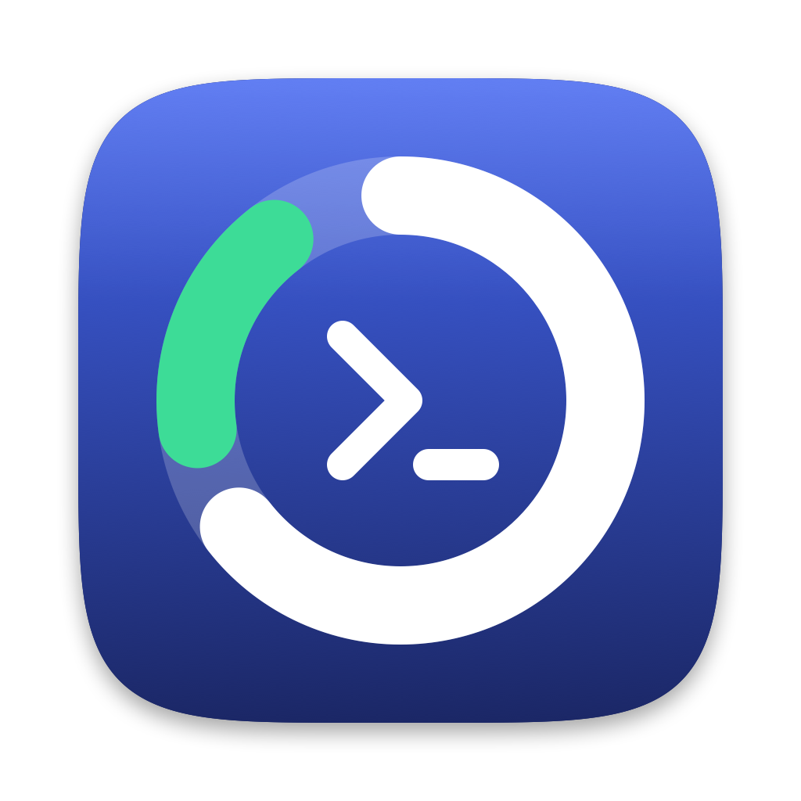

<p align="center">
  
</p>

<h1 align="center">Mac Cleaner</h1>

<p align="center"><strong>Disk cleaner for developers who ship with AI agents.</strong></p>

<p align="center">
  <a href="https://github.com/baturox/mac-cleaner/actions/workflows/ci.yml"></a>
  <a href="https://github.com/baturox/mac-cleaner/releases"></a>
  <a href="LICENSE"></a>
  
</p>

<p align="center">
  
</p>

<table>
  <tr>
    <td></td>
    <td></td>
  </tr>
  <tr>
    <td></td>
    <td></td>
  </tr>
</table>

Mac Cleaner is a free, open-source macOS app (with a command-line tool) that frees up the disk space developers actually lose: `node_modules` and Rust `target` folders in dozens of projects, duplicate git clones and worktrees left behind by coding agents, Claude Code / Cursor / Codex session data, Hugging Face and Ollama model downloads, npm / pnpm / uv / Homebrew caches, Xcode DerivedData and simulators, Docker images.

If your Mac says the disk is full and "System Data" is enormous, this is the tool that tells you which folders it really is, and which of them are safe to delete.

## Why another cleaner?

If you build many projects with AI coding agents (Claude Code, Cursor, Codex, ...), the disk fills up in ways a generic cleaner does not understand:

- the 34 GB that is "System Data" is one Rust `target` folder,
- 13 agent-made clones of the same repository, each with its own `node_modules`,
- months of agent transcripts and session data,
- three different model caches (Hugging Face, Ollama, LM Studio) holding models you tried once.

Mac Cleaner knows these places. It shows what each one is, how big it is, whether deleting it is safe, and when you last touched it. Then you choose.

## Features

- **Real disk numbers.** Free space right now, next to the "available" number Finder shows (free plus purgeable), with an explanation of the difference.
- **Grouped cleanup**, each item marked *safe* or *caution*:
  - System & apps
  - Package managers
  - Xcode & mobile
  - AI coding tools: Claude Code, Cursor, Windsurf, VS Code, Codex and Gemini CLI session data, orphaned workspace storage, old extension versions, Playwright browsers
  - AI models: Hugging Face, Ollama, LM Studio and others, picked one model at a time with last-used dates
  - Language toolchains: old Node, Rust and Python versions, Android SDK pieces
  - Containers & VMs: a Docker breakdown
  - Personal data
- **Projects.** Stale build folders (`node_modules`, `target`, `.next`, `Pods`, `.venv`, ...) across all your projects, with how long each project has been idle.
- **Repos.** Every clone and worktree, grouped by repository, with a "clean & pushed" status, so leftover agent worktrees can be removed without losing work.
- **Explore.** Drill down by size, like a disk-usage tree.
- **What grew.** What got bigger since the last scan: the answer to "what filled my disk?".
- **Menu bar item** with a low-space warning.
- **Delete permanently or move to the Trash**, and **protected folders** that are never touched.
- **A CLI** with `--json` output on every read command.

## Install

### Download (recommended)

1. Download `MacCleaner-<version>.dmg` from the [latest release](https://github.com/baturox/mac-cleaner/releases/latest).
2. Open it and drag **Mac Cleaner** to **Applications**.
3. Read the next section before the first launch.

Each release also contains a `.zip` of the app, a CLI-only `.tar.gz`, and `SHA256SUMS` to verify the downloads.

### First launch: the app is not notarized

Release builds are **ad-hoc signed and not notarized by Apple** (notarization needs a paid developer account; see [Releases](#releases-and-signing) below). macOS Gatekeeper therefore warns the first time you open a downloaded copy. To open it anyway, do one of these:

- Try to open the app once, then go to **System Settings > Privacy & Security** and click **Open Anyway** next to the Mac Cleaner message. On macOS 14 you can also right-click the app and choose **Open**.
- Or remove the quarantine flag in Terminal:

  ```sh
  xattr -dr com.apple.quarantine "/Applications/Mac Cleaner.app"
  ```

You are free to read the source and [build it yourself](#build-from-source) instead.

### Homebrew

A Homebrew cask template is in [`packaging/homebrew/`](packaging/homebrew/mac-cleaner.rb), but **there is no tap yet**, so `brew install` does not work today. Once a tap (`baturox/homebrew-tap`) is published this section will say so.

### Build from source

Requires macOS 14+ and Xcode (or the Swift toolchain). No third-party dependencies.

```sh
git clone https://github.com/baturox/mac-cleaner.git
cd mac-cleaner
scripts/build-app.sh --open      # builds dist/Mac Cleaner.app (universal) and opens it
```

### Install the command-line tool

The app contains the CLI at `Mac Cleaner.app/Contents/Resources/bin/mac-cleaner`. To put it on your `PATH`:

```sh
scripts/install-cli.sh           # symlinks into /usr/local/bin or ~/.local/bin
```

Or build only the CLI with `swift build -c release --product mac-cleaner` and run `.build/release/mac-cleaner`.

## Full Disk Access

macOS hides parts of your home folder (Mail, Messages, Safari data, some app containers) from programs that have not been granted **Full Disk Access**. Without it, some sizes come out too small and some deletions fail with "operation not permitted". Mac Cleaner works without it, and the Overview tells you when it is missing.

To grant it: **System Settings > Privacy & Security > Full Disk Access**, add *Mac Cleaner*. For the CLI, grant it to your terminal app. `mac-cleaner doctor` reports the current status. Mac Cleaner never asks for more than that.

## Using the app

1. **Overview** shows free space now versus "available", the biggest things you can reclaim, and what grew since the last scan.
2. **Cleanup** lists categories by group. Tick what you want, review the list, confirm. Models, toolchain versions and simulator runtimes can be picked one by one.
3. **Projects** lists rebuildable build folders with project idle time. Old, idle, big ones first.
4. **Repos** lists every clone and worktree by repository, with its status. Remove the ones that are fully backed up: committed, pushed to a network remote, and with no ignored files (such as `.env`) that exist only there. A copy that is not backed up can only be selected after you turn on *Allow removal* for that one copy and type a confirmation phrase.
5. **Explore** drills into any folder by size.

Settings hold the protected folders and how old AI session data must be before it is offered (default 30 days). Both are stored in `~/Library/Application Support/MacCleaner/settings.json`, which the command-line tool reads too, so a folder you protect in the app is protected in the CLI. Deleting can be permanent or move items to the Trash.

## Using the CLI

```
mac-cleaner [command] [options]

  scan       Disk numbers and everything that can be reclaimed (default)
  clean      Delete selected categories (asks first)
  projects   Rebuildable build folders in idle projects
  repos      Every git clone and worktree, grouped, with backup status
  explore    The biggest children of a folder
  growth     Save a snapshot and show what grew since the previous one
  doctor     Explain the disk numbers and report the environment
```

Global options: `--json`, `--no-color`, `--protect <path>`, `--version`, `-h/--help` (also `mac-cleaner help <command>`). Colors appear only on a terminal.

**Protected folders and retention.** The CLI obeys the protected folders and the session retention period you set in the app (it reads the same `settings.json`). `--protect <path>` adds a folder for one run and can be repeated. `mac-cleaner doctor` prints the list in force. If the settings file exists but cannot be read, scanning continues with defaults and a warning, and every command that would delete **refuses to run** until the file is fixed (open the app once, or remove the file).

File names, branch names and labels are data: when they are printed for you, control characters and escape sequences in them are replaced by `�`. `--json` output is not rewritten (JSON escaping already neutralizes them). Exit codes: `0` success, `1` runtime failure (or some items could not be removed), `2` usage error, `130` cancelled with Ctrl-C.

Sizes use decimal units, like Finder (1 GB = 1,000,000,000 bytes). A "≤" in front of a size means an upper bound: only part of it is actually freed (the pnpm store, Docker's disk image).

### Scan

```
$ mac-cleaner scan
Disk  ███████████░░░░░░░░░░░░░  47% used
  Free now     263 GB   really free on the volume
  Available    281 GB   what Finder shows (includes 18.0 GB purgeable)
  Total        494 GB

Package managers  7.9 GB
  #  ID    Name                  Level      Size  What it is
  1  npm   npm / npx cache       safe     6.2 GB  Re-downloaded on demand
  2  bun   Bun install cache     safe     1.7 GB  Re-downloaded on demand

AI models  9.4 GB
  #  ID         Name                            Level      Size  What it is
  3  hf-models  Hugging Face downloaded models  caution  9.4 GB  Large model files, re-downloadable
  ...

Total reclaimable  42.7 GB  (31.5 GB safe, 11.2 GB caution)
```

(The categories above are illustrative; your machine will show its own.)

### Clean

```sh
mac-cleaner clean                          # interactive picker: 1,3-5, s = all safe, a = all
mac-cleaner clean --safe -n                # preview every safe category, delete nothing
mac-cleaner clean --safe --group packageManagers -y
mac-cleaner clean npm hf-models --trash    # specific ids, moved to the Trash
```

`--safe` selects "safe" categories, `--all` everything, `--group <name>` narrows either to one group (`system`, `packageManagers`, `xcode`, `aiTools`, `models`, `toolchains`, `containers`, `personal`). `--group` on its own means the **safe** categories of that group: "caution" categories are only ever selected by `--all` or by naming their ids. Explicit ids are added on top. Mac Cleaner prints the plan, including the items behind every category (the first 8 of each, then "… and N more" with their size), and asks for confirmation unless you pass `-y`. It **refuses to delete when it is not on a terminal and `-y` is missing**.

### Projects

```
$ mac-cleaner projects ~/Developer --days 60 -n
  #     Size  Idle  Folder        Project
  1  2.1 GB   4 mo  target        ~/Developer/acme/ledger
  2  812 MB   3 mo  node_modules  ~/Developer/acme/storefront
  3  406 MB   2 mo  .next         ~/Developer/acme/storefront

Total 3.3 GB  in 3 folders - all rebuildable (npm install, cargo build, …)
```

Options: `--days N` (default 30), `--min-mb N` (default 50), `--kind node_modules,target`, `--trash`, `-n`, `-y`. Folders that contain git-tracked files are never listed. Neither are the build folders of a repository whose git configuration is not trusted (see *Repos*), because checking them would mean running git there.

### Repos

```
$ mac-cleaner repos ~/Developer --multiple-only
acme/storefront  4 copies, 3.4 GB
     Size   Idle  Branch    Kind      Status                    Path
  1.9 GB    2 d   main      clone     3 uncommitted             ~/Developer/acme/storefront
  820 MB   40 d   agent-1   worktree  clean & pushed            ~/Developer/acme/storefront-wt-1
  410 MB   41 d   fix-cart  clone     clean & pushed            ~/Developer/old/storefront
  300 MB   90 d   main      clone     2 unpushed                ~/Desktop/storefront copy
```

Statuses: `clean & pushed`, `N uncommitted`, `N unpushed`, `no remote`, `N ignored-only`, `stash`, and `untrusted git config - not inspected`; worktrees are labeled in the *Kind* column.

- **Unpushed** counts commits reachable from `HEAD`, any local branch or any tag that no remote-tracking ref of a *network* remote contains. A detached `HEAD` with local commits counts. A remote that is a folder on this disk (a path or a `file://` URL) is not a backup: such a clone shows `no remote`.
- **Ignored-only** counts files and folders that git ignores and that are not build output: `.env`, local databases, editor settings. They exist only in that copy. Build folders (`node_modules`, `dist`, `target`, …) and droppings (`.DS_Store`, `*.pyc`, `*.log`) are not counted.
- A **linked worktree** on a branch keeps its commits in the main clone, so only its files matter. A *detached* worktree is backed up only if a network remote has its `HEAD`.
- **Untrusted git config.** A repository's own `.git/config` can name programs that git runs during ordinary commands (`core.fsmonitor`, content filters such as `filter.lfs.*`, `core.hooksPath`, aliases, includes…). Mac Cleaner reads the configuration first and, unless every setting is on a list of harmless ones, does **not run git in that repository at all**. It is listed with its size and the names of the offending settings, and it is never removed from here. Git LFS repositories fall under this (the LFS filter is a program); that is deliberate.

`repos --remove-clean` removes only working copies that are fully backed up (inspected, nothing uncommitted, nothing unpushed, no stash, no ignored-only files), **never forces**, and **always keeps at least one working copy of each repository**. Preview it with `-n`.

### Explore, growth, doctor

```sh
mac-cleaner explore ~/Library --top 8   # biggest children of a folder
mac-cleaner growth                      # snapshot + what grew since the previous one
mac-cleaner doctor                      # disk numbers, Full Disk Access, protected folders, tools found, APFS volumes, snapshots, swap
```

`doctor --json` is what we ask for in bug reports. It contains numbers, tool locations and your protected-folder list (remove that from the paste if the paths are private), but no other file names. The tool locations are the ones Mac Cleaner itself would run (see *Safety model*), which can differ from your shell's `PATH`.

### JSON output

Every read command takes `--json` and prints **only** JSON on stdout (progress and messages go to stderr). `--json` never deletes: with `clean`, `projects` and `repos` it implies `--dry-run`.

```sh
mac-cleaner scan --json | jq '.categories[] | {id, group, sizeBytes}'
mac-cleaner projects ~/Developer --json | jq '.totalBytes'
```

All documents carry `"schemaVersion": 1`; fields are only ever added within a schema version. Dates are ISO 8601 (UTC), sizes are bytes, and paths inside engine types are `file://` URLs.

| Command | Top-level fields |
| --- | --- |
| `scan` | `disk`, `categories[]` (id, name, detail, level, group, items[], commands, sizeBytes, sizeIsUpperBound, itemsSelectable), `exactBytes`, `upperBoundBytes`, `safeBytes`, `cautionBytes` |
| `clean -n` | `dryRun`, `mode`, `selected[]` (same as categories), `exactBytes`, `upperBoundBytes` |
| `projects` | `root`, `minDaysIdle`, `minBytes`, `kinds`, `artifacts[]` (url, kind, projectURL, sizeBytes, idleDays), `totalBytes` |
| `repos` | `root`, `groups[]` (id, name, remote, totalBytes, `clones[]` with `clone` (includes `ignoredFileCount` and, for a copy that was not inspected, `untrustedConfigKeys`), `isFullyBackedUp`, `wasInspected`, `status`, `removable`), `totalBytes`, `removable[]` |
| `explore` | `path`, `totalBytes`, `entries[]` (url, name, sizeBytes, isDirectory), `omittedCount` |
| `growth` | `disk`, `report` (previousDate, freeDeltaBytes, entries[]) |
| `doctor` | `cliVersion`, `macOSVersion`, `architecture`, `disk`, `fullDiskAccess`, `tools[]`, `apfsVolumes[]`, `apfsContainerFreeBytes`, `localSnapshots[]`, `swapBytes`, `settings` (file, status, protectedPaths, extraProtectedPaths, builtInProtectedPaths, sessionRetentionDays) |

`disk` is `{totalBytes, usedBytes, freeBytes, availableWithPurgeableBytes, purgeableBytes}`.

## What it cleans

| Group | Examples | Typical level |
| --- | --- | --- |
| System & apps | user caches, logs and crash reports, old temp files, app caches (VS Code, Slack, Chrome and other Electron apps), Time Machine local snapshots | safe |
| Package managers | npm, pnpm, Yarn, Bun, uv, pip, Poetry cache, Cargo registry, Go build and module caches, Gradle, CocoaPods, SwiftPM, Composer, Homebrew old versions | safe; the Maven local repository (it also holds artifacts you installed yourself) and Poetry's virtual environments are caution |
| Xcode & mobile | DerivedData (per project), device support files, simulator caches, simulator runtimes and devices (one at a time) | safe; runtimes and devices are caution |
| AI coding tools | session data and transcripts of Claude Code, Cursor, Windsurf, VS Code, Codex and Gemini CLI older than the retention period, orphaned workspace storage, old extension versions, Playwright browsers | session data and orphaned workspace storage (it holds editor chat history) are caution; the rest safe |
| AI models | Hugging Face, Ollama, LM Studio, one model at a time | caution |
| Language toolchains | old Node, Rust and Python versions, Android SDK pieces | caution |
| Containers & VMs | Docker unused images, containers and build cache (with a breakdown); only for a Docker daemon on this Mac, never a remote one | per item |
| Personal data | the Trash, Xcode archives, iPhone/iPad local backups; always opt-in | caution |

The exact list lives in `Sources/CleanerCore/` (`Categories.swift` and the files next to it); `mac-cleaner scan` shows what exists on your machine. Missing tools simply produce no category.

Some details that follow from the safety rules below:

- **Custom cache locations.** If an environment variable moves a tool's cache (`PLAYWRIGHT_BROWSERS_PATH`, `PUPPETEER_CACHE_DIR`, `UV_CACHE_DIR`, `COMPOSER_HOME`, `TF_PLUGIN_CACHE_DIR`, `CCACHE_DIR`, `HF_HOME`, `OLLAMA_MODELS`, `PYENV_ROOT`, `NVM_DIR`, …), the folder is used only when its content looks like that tool's data, only the matching entries are listed, they are always *caution*, and the category says which variable named the folder. Otherwise the variable is ignored.
- **Symlinked folders are not followed.** A cache folder that is reached through a symbolic link (say, `~/Library/Developer/Xcode/DerivedData` linked to another disk) is not listed and cannot be deleted through that path.
- **Temp files** are offered only when nothing inside them, at any depth, has changed for a week, never when they are sockets or FIFOs, and never when they belong to another user.
- **Project folders:** `.wrangler` is not treated as a build folder (its `state` is the local development database), and `.terraform` is only offered when git ignores it.

## Safety model

Mac Cleaner deletes files. These are the rules it follows, and the reasons you can trust (and verify) them:

- **Safe vs. caution.** *Safe* means the data is rebuilt or re-downloaded automatically (caches, build output, old versions): the worst case is a slower next build. *Caution* means real data you may want: the Trash, backups and archives, downloaded models, chat and agent history, toolchains. Caution items are never selected by `--safe` or by `--group` alone, and never preselected in the app.
- **Permanent delete or Trash.** You choose. Permanent deletion frees space at once and cannot be undone. Moving to the Trash is recoverable, but frees nothing until you empty it.
- **Never touches credentials or configuration.** Cleanup targets are caches, build output and data. Tokens, keys, settings and dotfiles are not on the list.
- **Protected folders.** Folders you protect in the app's Settings are never listed, measured for cleanup, or deleted, in the app and in the CLI alike (one shared settings file; `--protect` adds more for a single CLI run). A built-in list (SSH and GPG keys, cloud and registry credentials, keychains, AI-tool settings and memory) is always protected. Protected locations are recognized by file identity as well as by name, so a different letter case (`~/Library/keychains`) or another alias of the same folder is still refused.
- **A narrow deletion allow-rule.** The engine refuses to delete anything outside your home folder and the temp areas, and anything shallower than two levels below your home folder. A path must also be written in its canonical form: if any folder on the way to it is a symbolic link, the request is refused instead of being followed somewhere else.
- **Deletion cannot be redirected.** Folders are removed through open directory handles, one level at a time, never by re-reading a path. Symbolic links are removed as links and never followed, the walk never leaves the volume it started on, and if a folder is swapped for a link (or for another folder) while the deletion runs, that entry is left alone and reported. Permissions are only ever changed on folders *inside* the tree being removed, and are put back on any folder that survives.
- **Shared temp folders are treated as hostile.** In `/private/tmp` and the other temp areas, only files and folders that belong to you are listed or removed, and never through a symbolic link somebody else may have planted there.
- **Build folders are checked against git.** A build folder that contains git-tracked files is never reported.
- **Git repositories are treated as untrusted input.** A folder with a `.git` directory can come from an archive or a synced drive, and its configuration can make git run programs. Mac Cleaner audits each repository's configuration against a list of harmless settings before running git in it, and skips the repository entirely otherwise (see *Repos*). When it does run git, it uses `/usr/bin/git` only, without your global or system configuration, with file system monitors, hooks, pagers and every network transport switched off, and, where macOS allows it, inside a sandbox that can execute nothing but git, write nothing and reach no network.
- **Clones are only removable when backed up.** A working copy is removable only when it was inspected and has no uncommitted changes, nothing unpushed to a network remote, no stash and no ignored files that exist only there. The engine re-checks right before removing and refuses otherwise, unless you explicitly override it for that copy. An override is applied only to the copies you acknowledged, never to the rest of a batch. A copy with untrusted git configuration is refused even with an override. The CLI never overrides, and never removes the last working copy of a repository.
- **Helper programs.** System tools (`git`, `xcrun`, `tmutil`, `du`, `diskutil`) are only ever run from the system directories. Third-party tools (`brew`, `docker`, `ollama`, `pnpm`, `uv`, `go`) are looked up in the system directories first, then Homebrew, then folders in your home, and are used only if the file and its folder could not have been written by another non-admin account. Every helper gets a small constructed environment, not yours: no `DYLD_*`, `GIT_*`, `DOCKER_HOST` or proxy variables. The only commands that can be run are a fixed set of exact shapes (for example `ollama rm <model>`, `xcrun simctl delete <UUID>`, `docker --host <local socket> image prune -af`); identifiers read from disk must match a strict pattern before they become an argument.
- **Docker means the Docker on this Mac.** Docker categories appear only when the selected Docker endpoint is a local socket, the category shows that endpoint, and every prune command names it explicitly.
- **Everything is listed and confirmed first.** You see what will be removed and how big it is before anything is deleted, including the total number of files and folders behind the rows shown. `-n/--dry-run` shows the plan and does nothing. Right before deleting, anything that changed type since the scan (a folder that became a link or a file) is skipped and reported.
- **Recent AI sessions are kept.** Session data newer than the retention period (default 30 days) is never offered.
- **No network access, no telemetry.** Mac Cleaner makes no network connections and sends nothing anywhere. It runs local tools (`du`, `git`, `docker`, `ollama`, `tmutil`, `diskutil`) for what it reports.

What this does **not** protect against is listed under "Known limitations" in [SECURITY.md](SECURITY.md): above all, another program already running as you can do anything Mac Cleaner can.

Found a case where it did the wrong thing? Please [open an issue](https://github.com/baturox/mac-cleaner/issues/new/choose); for anything that could delete or run the wrong thing, report it privately as described in [SECURITY.md](SECURITY.md).

## FAQ

**Why did my free space not go up after cleaning?**
Usually one of three things. (1) You moved items to the Trash: space returns only when you empty it. (2) APFS local snapshots (Time Machine or a pending macOS update) keep deleted data on disk until they are removed; `mac-cleaner doctor` lists them. (3) Finder's "available" number includes *purgeable* space that macOS only releases on demand, so it can look better than reality. Mac Cleaner shows both numbers and measures the change in really-free space.

**Is it safe to delete `node_modules`?**
Yes, in the sense that `npm install` (or `pnpm`/`yarn`/`bun install`) rebuilds it from the lockfile, as long as you have network access and your dependencies still resolve. That is why `node_modules`, `target`, `.next`, `Pods` and `.venv` are listed under Projects and why only build folders without git-tracked files are shown. A project you have not touched for months may take a while to rebuild.

**Can it delete my source code?**
It never offers source folders. The only way a working copy goes away is `Repos` (or `repos --remove-clean`), which requires it to be committed, pushed to a network remote and free of ignored-only files, and always keeps one copy per repository. In the app you can override this for a single copy, after an explicit warning that says what would be lost.

**Why does a repository say "untrusted git config - not inspected"?**
Its `.git/config` contains a setting that can make git run a program (for example a Git LFS filter, `core.hooksPath` from a hook manager, an alias, or `core.fsmonitor`). Checking the repository would mean running git in it, and Mac Cleaner will not do that for a folder it has no reason to trust. The setting names are shown. Nothing is wrong with such a repository; it just has to be cleaned up by hand.

**Why is a clean, pushed repository not "backed up"?**
Most likely it contains files git ignores that are not build output: a `.env`, a local database, IDE settings. Those are on no remote, so deleting the folder would lose them. The status shows how many (`N ignored-only`).

**Why are Claude Code, Cursor or Codex sessions in the list?**
Agent transcripts and session databases grow without bound. They are marked *caution* because they are your history; only sessions older than the retention period are offered, and you pick what goes.

**Does it need admin rights?**
No. It works inside your home folder and temp areas. Some items (APFS snapshots) need system tools and may ask for confirmation by macOS.

**Intel Macs?**
Release builds are universal (Apple silicon and Intel). The minimum is macOS 14.

## Releases and signing

Release builds are produced by GitHub Actions from a tag, with `scripts/build-app.sh` and `scripts/package.sh`. Unless the maintainer has configured a Developer ID certificate and notarization credentials (see `.github/workflows/release.yml`), the build is **ad-hoc signed and not notarized**. Verify downloads against `SHA256SUMS`.

## Building and contributing

```sh
swift build                 # app + CLI + engine
swift test                  # hermetic tests
scripts/build-app.sh --open # app bundle in dist/
swift scripts/make-icon.swift  # regenerate the icon
```

See [CONTRIBUTING.md](CONTRIBUTING.md) for the project layout, the engine contract and how to add a cleanup category safely. Changes are listed in [CHANGELOG.md](CHANGELOG.md).

## License

[MIT](LICENSE) © 2026 baturox
